# Executive Live Collections Dashboard

> The General Manager sees every branch's collections live, from his phone wherever he is or the TV in his office, without anyone running a report.

**Status:** In production · **Client:** 250K-member electric cooperative · **Role:** Solo full-stack engineer

**Stack:** `React` `Node.js` `MS SQL Server` `MapLibre` `PWA` `Cloudflare Tunnel`

> [!NOTE]
> **Showcase repository.** The source code is private and belongs to the client. This repo documents the problem, the architecture, and the results. Screens show demo data. Full case study: https://lesjohnpauloliver.dev/work/executive-live-collections-dashboard

## Summary

A live collections command center for the General Manager: every area, branch, teller, and partner channel, on his phone anywhere he goes and on the TV in his office, read safely from the production billing database.

## Scale

- About 280,000 consumer accounts across every area office and partner channel
- Live data refreshed every 30 seconds; heavy ledger figures hourly
- Ledger tables of 25 million+ rows, read through a pool capped at 3 connections
- 120 automated tests

## The problem

- The General Manager only saw collections in end-of-day reports compiled by hand, so a bad day was found after it was over.
- Area totals did not reconcile, because the billing system's area code lumps one area into another.
- Voided receipts were buried in an audit table nobody queried.
- A 10 AM total next to yesterday's full day made every morning look like a collapse.
- Accounting pulled monthly efficiency figures by hand from very large ledger tables.
- The database runs billing for the whole cooperative, so any dashboard that slowed it down would be switched off.

## Problem → fix

### The General Manager could only learn the day's collections from end-of-day reports, and only at the office.

A live dashboard on his phone, wherever he goes: today's collections, every area and branch, partner channels, new connection applications, and a live payment feed, refreshed every 30 seconds over a secure tunnel.

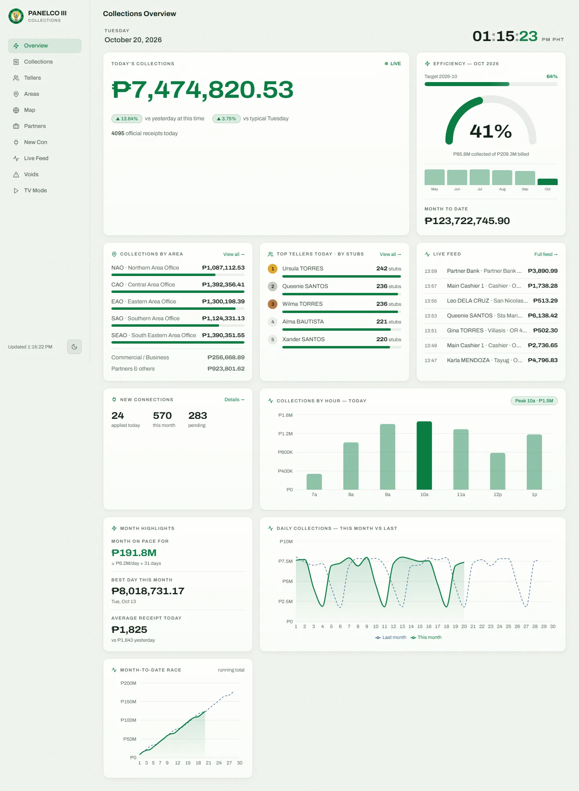
Overview: today's collections against yesterday at this time and a typical same weekday, efficiency, areas, top tellers, live feed, and hourly and daily charts.
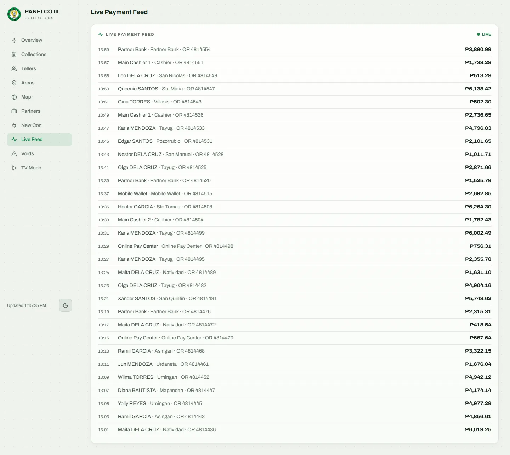
Live payment feed, updated as receipts are issued across branches and partner channels.
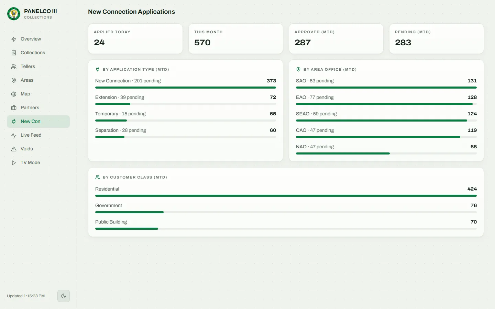
New connection applications today and this month, by type, class, and area.
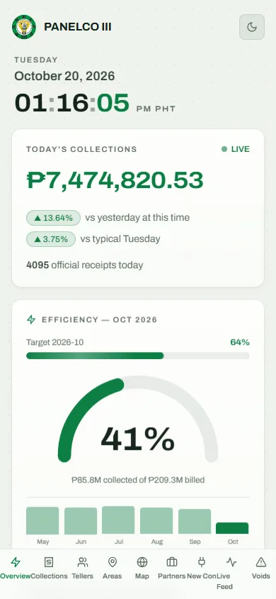
On the General Manager's phone: an installable app with today's total first.

### The management office had no shared, at-a-glance view of how the day was going.

A TV mode with large type and auto-rotating panels runs on the office wall with no one touching it, and a 3D map tours each municipality with columns sized by today's collections.

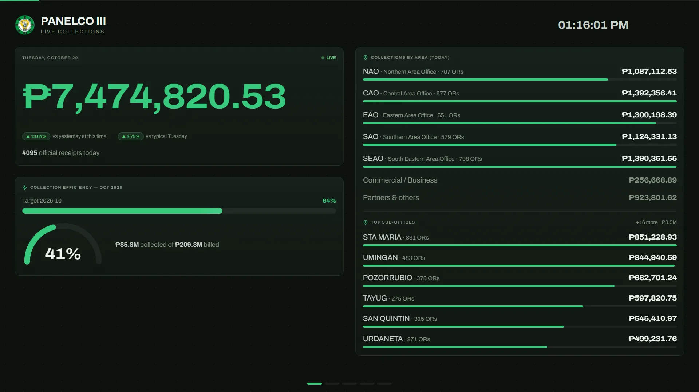
Office TV mode: large type and auto-rotating panels, with no one touching it.
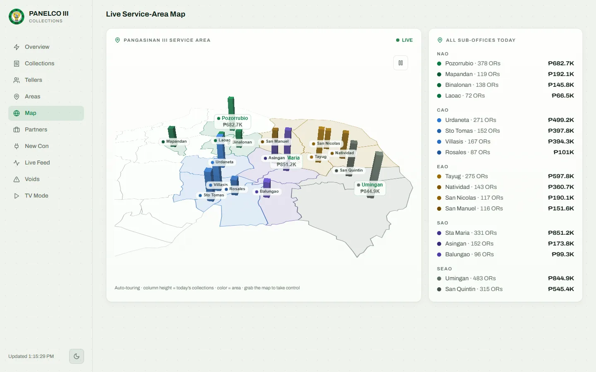
3D live map: each municipality's column height is today's collections, colored by area.
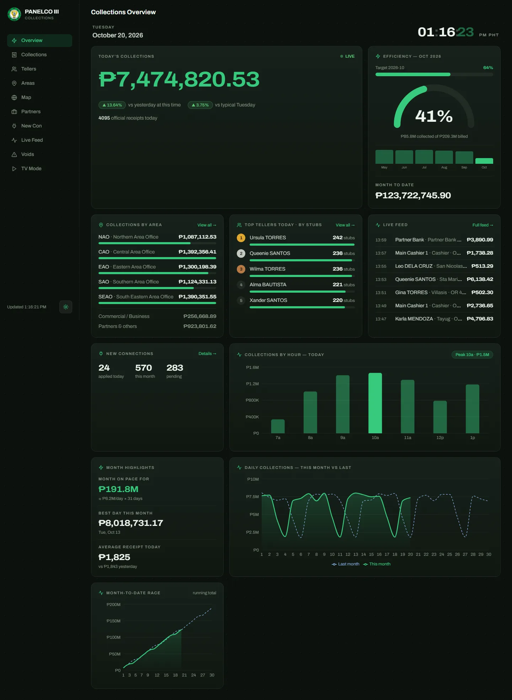
The same overview in dark mode.

### A 10 AM total next to yesterday's full day made every morning look like a collapse.

Today is compared with yesterday at this same time and with a typical same weekday (the average of the last four), prorated to the minute.

### Area totals did not reconcile, so one area's performance was invisible and another's was inflated.

Collections are grouped by the teller roster instead of the broken area code, so areas, commercial accounts, and partner channels always add up to the headline total. Area managers see only their own area, enforced on the server.

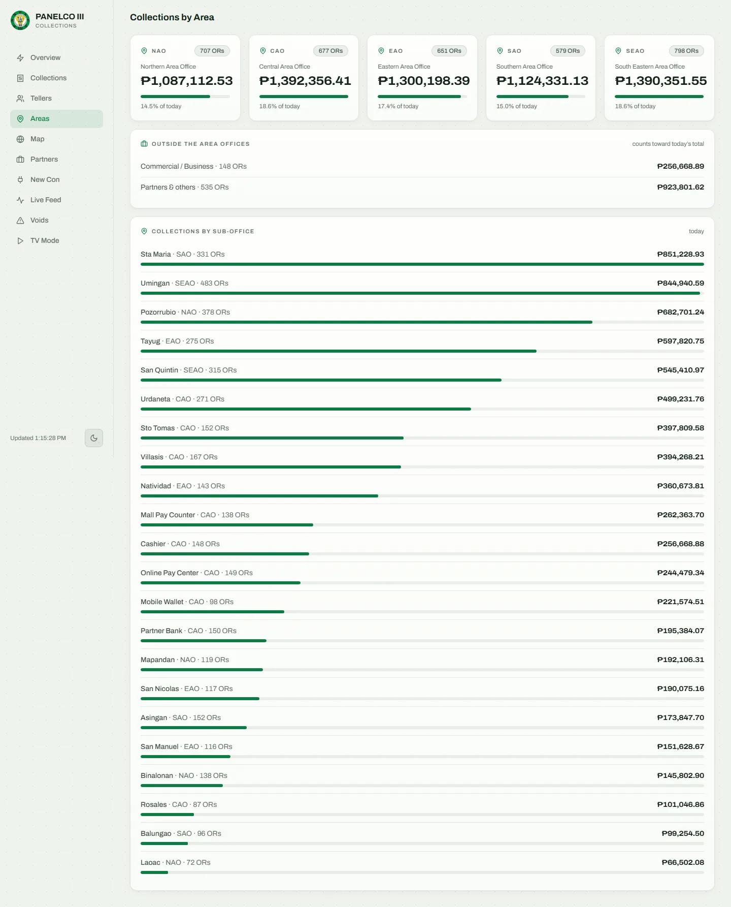
Collections by area and branch, reconciled to the headline total.
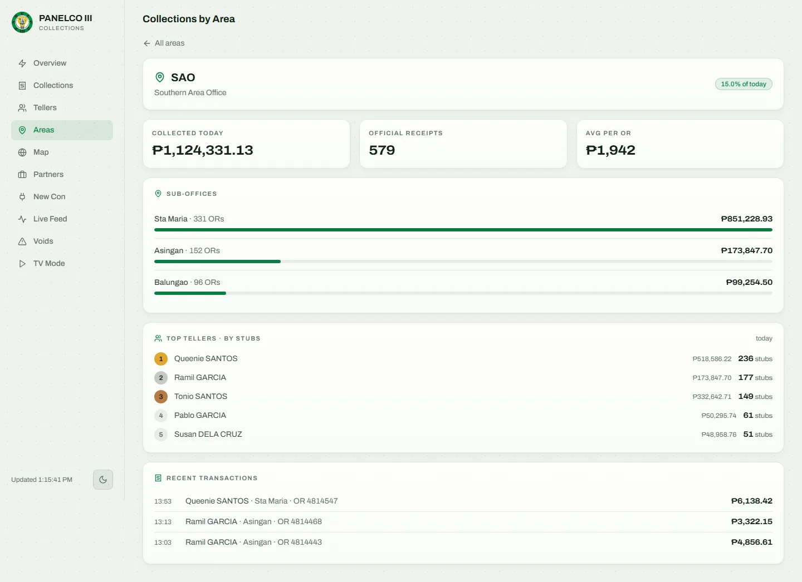
Area detail: what an area manager sees, scoped to their own area on the server.
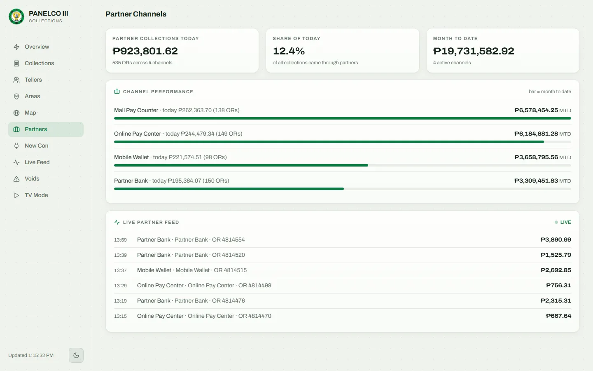
Partner channels: banks, payment centers, and wallets, classified automatically.

### Teller mistakes were invisible, so rework and lost time could not be measured or coached.

Tellers are ranked by stubs within volume tiers, with speed and clean rate, and an OR Waste Watch prices each voided receipt in minutes of teller time. Void trends, top reasons, and repeat offenders sit one tap away.

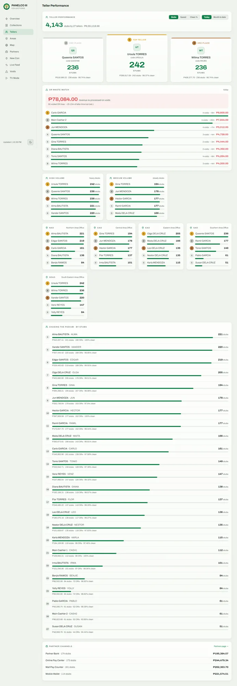
Teller performance: podium, volume tiers, area leaderboards, and OR Waste Watch.
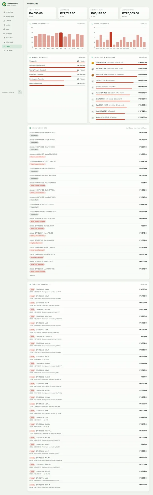
Voided receipts by day and month, top reasons, and repeat offenders.
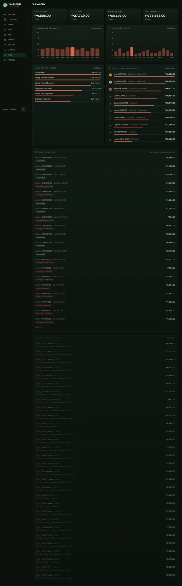
Voided receipts in dark mode.

### Accounting's monthly efficiency figures took hours by hand, and ad-hoc ledger queries could pin the production database.

A per-bill-month report shows efficiency, uncollected receivables, and never-paid bills, with a streamed CSV export of about 280,000 rows. Filtering the ledger on one transaction type turned a 19.3 s scan into a 1.45 s index seek.

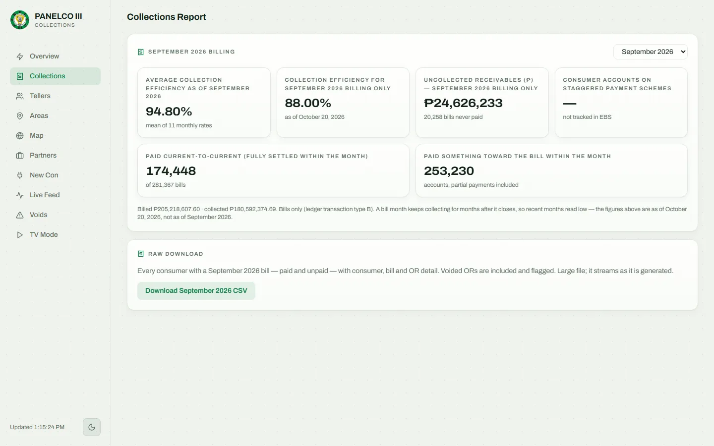
Accounting's report: collected against billed per bill month, uncollected receivables, and a raw export.

### The database runs billing for the whole cooperative, so a dashboard that slowed it down would be switched off.

A read-only login, a pool capped at 3 connections, and one server that polls and serves every screen from memory, so any number of viewers costs one database reader. If a source fails, the last good data stays on screen with a stale badge.

## Approach

- One Node.js service polls the billing database on its own schedule and serves every screen from an in-memory snapshot.
- Live figures refresh every 30 seconds and heavy ledger aggregates hourly; a source skips a tick while its last run is still going, so slow queries never stack up.
- Collections are grouped by the teller roster, not the billing system's area code, so every total reconciles to the peso.
- Role scoping on the server: the General Manager sees everything, area managers only their own area, accounting only its report, and the TV gets a long kiosk session.
- Reachable from anywhere through a Cloudflare Tunnel, while the server itself listens only on the local machine.

## What was built

- Live overview with honest same-time comparisons, efficiency gauge, and hourly and daily charts
- Collections by area and branch, partner channels, and a live payment feed
- Teller performance with OR Waste Watch and void analytics
- 3D live map of the service area
- Accounting's billing-month report and raw CSV export
- Office TV mode and an installable phone app

## Capabilities

**Live collections**
- Today's total and receipt count against yesterday at this time and a typical same weekday
- Collections by area, branch, commercial accounts, and partner channels, reconciled to the headline total
- Live payment feed and hourly and daily charts, this month against last
- Month-on-pace forecast, best day, and average receipt
- New connection applications by type, class, and area

**Teller performance**
- Podium and area leaderboards ranked by stubs, within high, medium, and light volume tiers
- Speed in stubs per hour and clean rate
- OR Waste Watch: each voided receipt priced in minutes of teller time
- Voids per day and month, top reasons, and top offenders over 12 months, with a drill-down per teller

**Reports**
- Collected against billed per bill month, with a target progress bar
- Uncollected receivables and never-paid bills
- Streamed CSV export of about 280,000 rows, with account numbers kept intact for Excel
- Metrics the billing data cannot support show as not tracked instead of a misleading number

**Displays and access**
- Office TV mode: dark, large type, auto-rotating panels, and a 3D map that tours each municipality
- Installable phone app with bottom navigation, plus light and dark themes
- Signed session cookies, scrypt password hashes, and a per-IP login throttle
- Server-side role scoping for the General Manager, area managers, accounting, and the TV

## Architecture

- Production billing database (read-only login) and the new-connection database → one Node.js and Express service with a pooled connection cap of 3 → in-memory snapshot → every screen.
- The service runs 24/7 as a Windows service and is reached through a Cloudflare Tunnel; it binds only to the local machine.
- The phone app, area managers' views, accounting's report, and the office TV all read the same snapshot, so N viewers cost one database reader.
- The React front end uses Recharts for charts and MapLibre for the 3D extruded map.

## Engineering

- Filtering ledger queries on one transaction type turned a 19.3 s scan into a 1.45 s index seek, 13 times faster.
- The CSV export refuses to run unless its supporting index exists, which stops a repeat of the 25-million-row scan that once pinned database CPU.
- The export streams with back-pressure, handles clients that disconnect or stall, and runs one at a time, so a cancelled download cannot leak a database connection.
- When a source fails, the last good data stays on screen with a stale badge instead of going blank.
- 120 node:test tests cover data shaping, area scoping, auth, CSV encoding, routes, and the export stall and abort paths.

## Where AI does the work

Automation turns raw payment lines into the numbers an executive acts on: pace, honest comparisons, efficiency, and money lost to voided receipts, refreshed all day without anyone running a report.

## Outcome

- The General Manager follows every branch's collections live, from his phone anywhere or the TV in his office.
- Area totals now reconcile to the peso, and teller voids are measured instead of hidden.
- Any number of viewers costs one database reader, through a login that cannot write.

---

Built by **[Les John Paul Oliver](https://lesjohnpauloliver.dev)**, AI Engineer in the Philippines: agentic AI, RAG, LLM evals, MCP, and business automation. [Case studies](https://lesjohnpauloliver.dev/#projects) · [Hire me](https://lesjohnpauloliver.dev/ai-engineer-philippines)
